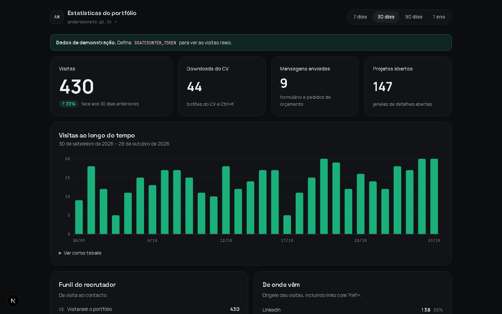

# Portfolio Analytics

[](https://github.com/anderson-fullstack-developer/portfolio-analytics/actions/workflows/ci.yml)


Private analytics dashboard for my portfolio ([andersonneto.gt.tc](https://andersonneto.gt.tc)), built on top of the GoatCounter API.

GoatCounter collects the data without cookies and without storing IP addresses; this app turns it into the questions that matter for a developer portfolio: *who opened my portfolio, did they download my CV, and which projects caught their attention?*



*Demo mode with sample data. The real dashboard is password-protected.*

## Features

- **Visits over time** with 7 / 30 / 90 day and 1 year ranges (weekly buckets for the year), hover tooltip, keyboard navigation and a table view.
- **Recruiter funnel**: visited → opened project details → downloaded CV → got in touch.
- **Job applications**: links shared as `?ref=company-name` are detected and listed per company.
- **Traffic sources**, most viewed projects, pages, countries and devices.
- **Password-protected** with an HMAC-signed, `httpOnly` session cookie; `noindex` headers keep it out of search engines.
- **Demo mode**: without an API token it renders realistic sample data, so the UI can be developed offline.

## Stack

Next.js 15 (App Router, Server Components) · React 19 · TypeScript · hand-built SVG charts (no chart library) · GoatCounter API · Vercel.

The API token lives only on the server; responses are cached for 5 minutes to respect GoatCounter's rate limits.

## Running locally

```bash
npm install
cp .env.example .env.local   # fill in the values
npm run dev                  # http://localhost:3000
```

| Variable | Purpose |
|---|---|
| `GOATCOUNTER_SITE` | GoatCounter account code (`andersonneto`) |
| `GOATCOUNTER_TOKEN` | API token with *read statistics* permission |
| `DASHBOARD_PASSWORD` | Password to access the dashboard |
| `SESSION_SECRET` | Long random string used to sign the session |

Without `DASHBOARD_PASSWORD`, the dashboard is open in development only; in production it always requires login.

## Deploying

Import the repository in Vercel, set the four environment variables, and deploy.

## Author

**Anderson Neto**, Full-Stack Developer in Lisbon. [Portfolio](https://andersonneto.gt.tc) · [LinkedIn](https://linkedin.com/in/anderson-fullstack-developer)

## License

[MIT](LICENSE)
